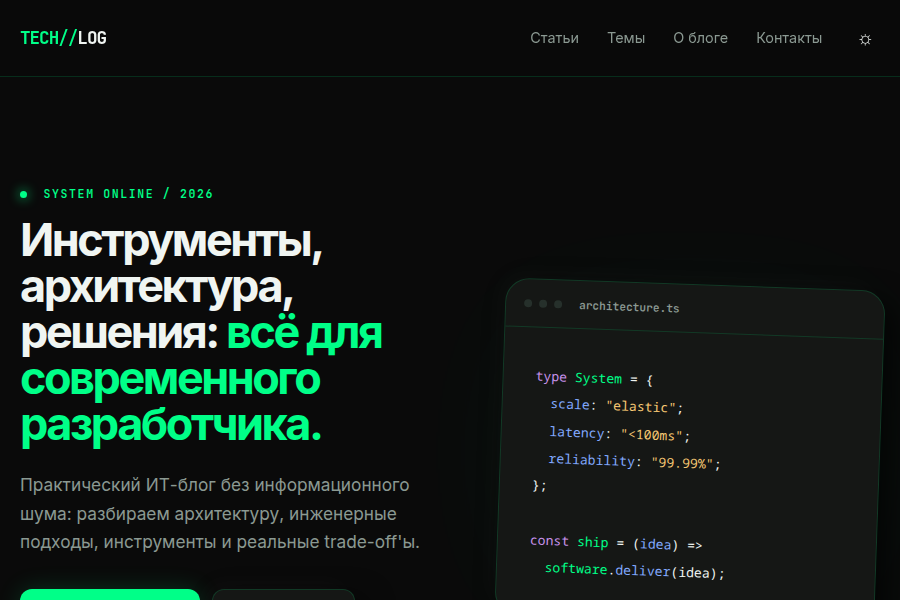

# Laravel Orchid Blog

Блог на базе **Laravel** с административной панелью **[Orchid](https://orchid.software/)**.



## О проекте

Публичный шаблон блога на **Laravel 13** + **Orchid Platform 14**. Публичная часть — Blade/Vite с тёмной темой, SEO-разметкой, RSS, sitemap, JSON-LD и гостевыми комментариями с математической капчей. Админка — Orchid с CRUD статей, рубрик, меток, модерацией комментариев и управлением подписчиками. Подписка на рассылку с автопубликацией запланированных статей и отправкой писем через очередь. Полная поддержка 152-ФЗ (согласия и отзывы ПДн).

## Быстрый старт

```bash
make install
```

Сайт `:8080`, админ `:8080/nexus` (`admin@localhost.ru` / `123456`).

## Документация

| Раздел | Файл |
|---|---|
| Возможности «из коробки» | [docs/features.md](docs/features.md) |
| Используемые технологии | [docs/technologies.md](docs/technologies.md) |
| Установка и запуск | [docs/installation.md](docs/installation.md) |
| Что поменять после создания | [docs/configuration.md](docs/configuration.md) |
| Деплой на продакшн | [docs/deployment.md](docs/deployment.md) |
| Структура проекта | [docs/project-structure.md](docs/project-structure.md) |
| Архитектура | [docs/architecture.md](docs/architecture.md) |
