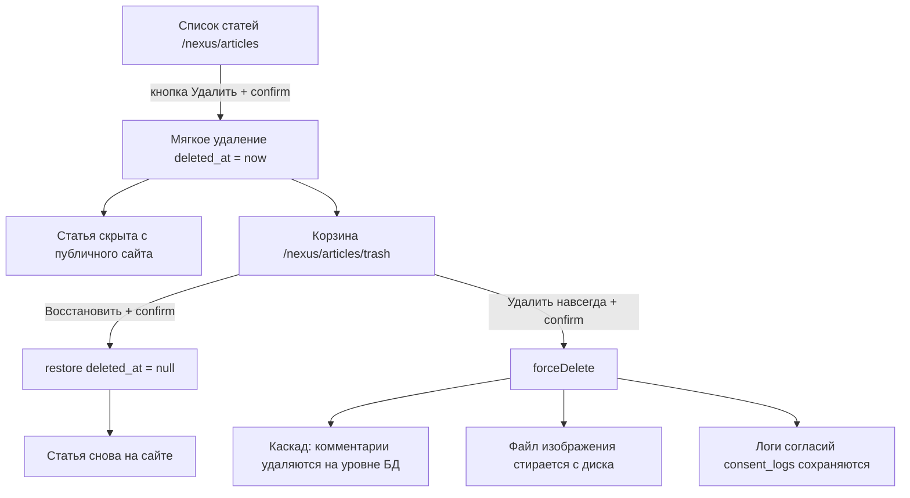

# План: функционал удаления статей (мягкое удаление + корзина)

## 1. Цель и место в архитектуре

- **Что делаем:** полноценное удаление статей в админ-панели Orchid (`/nexus`):
  - кнопка «Удалить» (мягкое удаление, `SoftDeletes`) в списке статей;
  - отдельный экран «Корзина» со списком удалённых статей;
  - восстановление статьи из корзины;
  - удаление навсегда (force delete) с очисткой файла изображения.
- **Куда встраиваем (конвенция проекта, см. AGENTS.md):**
  - кнопка удаления — [`app/Orchid/Layouts/Article/ArticleListTable.php`](app/Orchid/Layouts/Article/ArticleListTable.php:61) (сейчас там закомментированная строка `// TD::make('delete', 'Удалить')->but,`);
  - метод удаления — [`app/Orchid/Screens/Article/ArticleListScreen.php`](app/Orchid/Screens/Article/ArticleListScreen.php);
  - новый экран корзины — `app/Orchid/Screens/Article/ArticleTrashListScreen.php`;
  - новый лейаут таблицы корзины — `app/Orchid/Layouts/Article/ArticleTrashTable.php`;
  - маршрут — [`routes/platform.php`](routes/platform.php:46);
  - пункт меню — [`app/Orchid/PlatformProvider.php`](app/Orchid/PlatformProvider.php:63).
- **Ключевые правила:**
  - мягкое удаление — основной сценарий: статья скрывается с публичного сайта, данные и изображение сохраняются (можно восстановить);
  - удаление навсегда — только из корзины, с подтверждением, необратимо;
  - переиспользуем готовую инфраструктуру: `SoftDeletes` в [`Article`](app/Models/Article.php:78), события `deleted`/`restored`/`forceDeleted` в [`ArticleObserver`](app/Observers/ArticleObserver.php:74) (пересчёт `count_articles` у тегов);
  - паттерн кнопки/метода удаления — как в [`SubscriberListScreen`](app/Orchid/Screens/Subscriber/SubscriberListScreen.php:84) (`Button::method('remove')` + `confirm()` + `parameters()` + `remove(Request $request)` + `Toast`).

## 2. Текущее состояние (что уже готово)

- [ ] `Article` использует `SoftDeletes` — колонка `deleted_at` есть в [`create_articles_table`](database/migrations/2022_05_19_124837_create_articles_table.php:44), доступны `onlyTrashed()`, `withTrashed()`, `restore()`, `forceDelete()`.
- [ ] [`ArticleObserver`](app/Observers/ArticleObserver.php:74) уже обрабатывает `deleted`, `restored`, `forceDeleted` — все три вызывают `Tag::updateCountArticles()` (пересчёт счётчика статей у тегов; мягко удалённые статьи автоматически исключаются глобальным скоупом `SoftDeletes`).
- [ ] Публичные выборки (`Article::published()`, [`ArticleService`](app/Services/ArticleService.php:21), `/notpublic`) не показывают мягко удалённые статьи — глобальный скоуп работает автоматически, менять их не нужно.
- [ ] Комментарии: FK `comments.article_id` → `cascadeOnDelete` ([миграция](database/migrations/2022_05_20_151425_create_comments_table.php:24)) — при force delete комментарии удаляются на уровне БД.
- [ ] Логи согласий: `consent_logs.comment_id` → `nullOnDelete` ([миграция](database/migrations/2026_09_26_150000_make_comment_id_nullable_on_consent_logs_table.php:28)) — переживают удаление комментариев; полиморфные `subject_type`/`subject_id` сохраняют историческую привязку.
- [ ] Изображения статей — `storage/app/public/articles/` (диск `public`); паттерн удаления файла уже есть в [`ArticleListScreen::createOrUpdateArticle()`](app/Orchid/Screens/Article/ArticleListScreen.php:164).
- [ ] В [`docs/features.md`](docs/features.md:52) заявлен «CRUD статей», но удаление не реализовано — план закрывает расхождение.

## 3. Схема работы



## 4. Шаг 1 — кнопка «Удалить» в списке статей

- [ ] В [`app/Orchid/Layouts/Article/ArticleListTable.php`](app/Orchid/Layouts/Article/ArticleListTable.php:61) заменить закомментированную строку на колонку с кнопкой:

```php
TD::make('Удалить')
    ->render(function (Article $article) {
        return Button::make('')
            ->icon('trash')
            ->method('remove')
            ->confirm('Удалить статью «' . $article->title . '»? Статья будет перемещена в корзину.')
            ->parameters(['article' => $article->id]);
    }),
```

- [ ] Добавить импорт `use Orchid\Screen\Actions\Button;` в `ArticleListTable.php`.
- [ ] В [`app/Orchid/Screens/Article/ArticleListScreen.php`](app/Orchid/Screens/Article/ArticleListScreen.php) добавить метод (паттерн `SubscriberListScreen::remove()`):

```php
public function remove(Request $request): void
{
    Article::findOrFail($request->integer('article'))->delete();

    Toast::info('Статья перемещена в корзину.');
}
```

- [ ] Добавить импорт `use Illuminate\Http\Request;` в `ArticleListScreen.php`.
- [ ] `query()` списка менять не нужно: `Article::filters()` по умолчанию исключает мягко удалённые статьи (глобальный скоуп).
- [ ] Примечание: `findOrFail` исключает уже удалённые статьи — повторный клик/двойная отправка даст 404, что приемлемо (подтверждение `confirm()` закрывает основной сценарий).

## 5. Шаг 2 — экран «Корзина»

- [ ] Создать `app/Orchid/Screens/Article/ArticleTrashListScreen.php`:

```php
<?php

namespace App\Orchid\Screens\Article;

use App\Models\Article;
use App\Orchid\Layouts\Article\ArticleTrashTable;
use Illuminate\Http\Request;
use Illuminate\Support\Facades\Storage;
use Orchid\Screen\Actions\Link;
use Orchid\Screen\Screen;
use Orchid\Support\Facades\Layout;
use Orchid\Support\Facades\Toast;

class ArticleTrashListScreen extends Screen
{
    public function query(): iterable
    {
        return [
            'articles' => Article::onlyTrashed()
                ->with('rubric')
                ->orderBy('deleted_at', 'desc')
                ->paginate(24),
        ];
    }

    public function name(): ?string
    {
        return 'Корзина статей';
    }

    public function commandBar(): iterable
    {
        return [
            Link::make('Назад к статьям')
                ->route('platform.articles')
                ->icon('arrow-left'),
        ];
    }

    public function layout(): iterable
    {
        return [
            ArticleTrashTable::class,
        ];
    }

    public function restore(Request $request): void
    {
        Article::onlyTrashed()->findOrFail($request->integer('article'))->restore();

        Toast::info('Статья восстановлена.');
    }

    public function forceDelete(Request $request): void
    {
        $article = Article::onlyTrashed()->findOrFail($request->integer('article'));
        $image = $article->image;

        $article->forceDelete();

        // Очистка файла изображения (паттерн — ArticleListScreen::createOrUpdateArticle).
        if ($image && Storage::disk('public')->exists($image)) {
            Storage::disk('public')->delete($image);
        }

        Toast::info('Статья удалена навсегда.');
    }
}
```

- [ ] Примечание: в `query()` используем `orderBy('deleted_at', 'desc')`, а не `defaultSort()` — `deleted_at` отсутствует в `Article::$allowedSorts`, и Orchid-`defaultSort()` молча проигнорирует сортировку.
- [ ] Создать `app/Orchid/Layouts/Article/ArticleTrashTable.php` — таблица (`$target = 'articles'`, `$tableResponsive = true`, `striped()`) с колонками:
  - `TD::make('id', 'ID')->sort()->width(55)`;
  - `TD::make('title', 'Заголовок')`;
  - `TD::make('rubric_title', 'Категория')` → `$article->rubric?->title ?? '—'`;
  - `TD::make('deleted_at', 'Дата удаления')` → `$article->deleted_at?->format('d.m.Y H:i') ?? ''` (без `->sort()`, колонки нет в `$allowedSorts`);
  - колонка «Восстановить»: `Button::make('')->icon('arrow-repeat')->method('restore')->confirm('Восстановить статью «' . $article->title . '»?')->parameters(['article' => $article->id])`;
  - колонка «Удалить навсегда»: `Button::make('')->icon('trash')->method('forceDelete')->confirm('Удалить статью «' . $article->title . '» навсегда? Комментарии будут удалены, изображение стёрто с диска. Действие необратимо.')->parameters(['article' => $article->id])`.
- [ ] В [`routes/platform.php`](routes/platform.php:46) зарегистрировать маршрут рядом с `platform.articles`:

```php
Route::screen('articles/trash', ArticleTrashListScreen::class)
    ->name('platform.articles.trash');
```

- [ ] В [`app/Orchid/PlatformProvider.php`](app/Orchid/PlatformProvider.php:63) добавить пункт меню после «Статьи»:

```php
Menu::make(__('Корзина статей'))
    ->icon('bs.trash')
    ->permission('platform.custom.articles')
    ->route('platform.articles.trash')
    ->badge(function () {
        return Article::onlyTrashed()->count();
    }),
```

## 6. Шаг 3 — восстановление

- [ ] Метод `restore()` в `ArticleTrashListScreen` (см. Шаг 2): `Article::onlyTrashed()->findOrFail(...)->restore()`.
- [ ] Событие `restored` в [`ArticleObserver`](app/Observers/ArticleObserver.php:85) уже пересчитывает `count_articles` у тегов — дополнительных действий нет.
- [ ] Опубликованная статья после восстановления снова появляется на сайте: поля `is_published`/`published_at` не меняются, глобальный скоуп снимает `deleted_at`.

## 7. Шаг 4 — удаление навсегда (force delete)

- [ ] Метод `forceDelete()` в `ArticleTrashListScreen` (см. Шаг 2).
- [ ] Каскад комментариев: FK `comments.article_id` → `cascadeOnDelete` удаляет комментарии на уровне БД (включая мягко удалённые).
- [ ] Логи согласий: `consent_logs.comment_id` обнуляется (`nullOnDelete`), `subject_type='comment'`/`subject_id` сохраняют историческую запись — журнал ПДн не теряется.
- [ ] Очистка изображения: `Storage::disk('public')->delete($article->image)` с проверкой `exists()` (см. Шаг 2).
- [ ] Событие `forceDeleted` в [`ArticleObserver`](app/Observers/ArticleObserver.php:96) уже пересчитывает `count_articles` у тегов.
- [ ] Принятое поведение: sitemap и RSS кэшируются 1 час — после удаления статья может оставаться в кэше до истечения срока (инвалидация кэша не вводится, конвенция проекта: «никаких кэш-ключей и инвалидации кэша нет»).

## 8. Права доступа

- [ ] Экран корзины защищён так же, как список статей: пункт меню с `->permission('platform.custom.articles')` (см. Шаг 2).
- [ ] Опционально (defense in depth): добавить `->middleware('access:platform.custom.articles')` к маршрутам `platform.articles` и `platform.articles.trash` в [`routes/platform.php`](routes/platform.php:46) — алиас `access` уже зарегистрирован (см. AGENTS.md).

## 9. Тесты

Новый файл `tests/Feature/ArticleDeleteTest.php` (паттерн — [`CommentScreenTest`](tests/Feature/CommentScreenTest.php:16): хелпер `adminWithPlatformAccess()` с `permissions = ['platform.index' => true]`; вызов методов экрана — POST на `{path}/{method}`, как `/nexus/comment/{id}/approve`):

- [ ] `test_article_can_be_soft_deleted_from_list`: POST `/nexus/articles/remove` с `['article' => $id]` → `assertSoftDeleted('articles', ['id' => $id])`; статья не видна на публичной странице (`GET /` → `assertDontSee(title)`).
- [ ] `test_trash_screen_lists_deleted_articles`: после мягкого удаления GET `/nexus/articles/trash` → `assertOk()` + `assertSee(title)`.
- [ ] `test_article_can_be_restored`: POST `/nexus/articles/trash/restore` с `['article' => $id]` → `assertNotSoftDeleted('articles', ['id' => $id])`; статья снова видна на сайте.
- [ ] `test_article_can_be_force_deleted_with_image_and_comments`: `Storage::fake('public')`, создать статью с изображением (`articles/test.jpg`) и комментарием; мягко удалить, затем POST `/nexus/articles/trash/forceDelete` с `['article' => $id]` → `assertDatabaseMissing('articles', ['id' => $id])`, `Storage::disk('public')->assertMissing('articles/test.jpg')`, `assertDatabaseMissing('comments', ['id' => $comment->id])`.
- [ ] `test_consent_logs_survive_force_delete`: создать `ConsentLog` для комментария (фабрикой или напрямую) → после force delete `assertDatabaseHas('consent_logs', ['id' => $log->id, 'comment_id' => null])`.
- [ ] `test_tag_count_updated_after_delete_and_restore`: опубликованная статья с тегом → после мягкого удаления `count_articles` тега уменьшается, после восстановления — возвращается (проверка через `Tag::find(...)->count_articles`).
- [ ] Примечание: если URL-паттерн вызова метода экрана в тестах не совпадёт (например, Orchid ожидает `method` в теле POST на сам экран), сверить с атрибутом `action` сгенерированной кнопки в HTML списка.

## 10. Документация

- [ ] [`docs/features.md`](docs/features.md:52): в разделе «Админ-панель Orchid» уточнить пункт «CRUD статей» — добавить «удаление в корзину, восстановление и удаление навсегда из корзины (с очисткой изображений)»; добавить строку «Корзина статей — восстановление и удаление навсегда».
- [ ] [`docs/architecture.md`](docs/architecture.md): описать экран `ArticleTrashListScreen`, таблицу `ArticleTrashTable` и семантику удаления (soft → корзина → restore/forceDelete).

## 11. Проверка

- [ ] `make lint` — синтаксис PHP без ошибок.
- [ ] `make test` — все тесты зелёные (PHPUnit).
- [ ] Ручная проверка: `make up`, в `/nexus/articles` удалить статью (подтверждение, Toast), убедиться что она исчезла с сайта; в `/nexus/articles/trash` восстановить и удалить навсегда статью с изображением; проверить счётчики тегов и отсутствие статьи в sitemap/RSS после истечения кэша.
