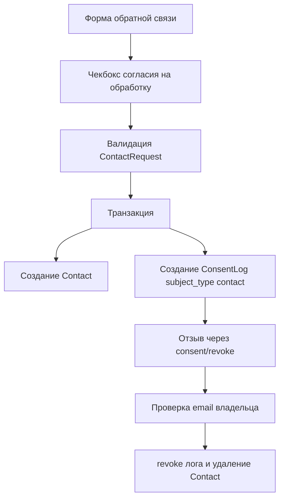

# План: согласие на обработку ПДн в форме обратной связи

> Рабочий план реализации. Добавляет в форму обратной связи чекбокс согласия на
> обработку персональных данных (152-ФЗ) по образцу формы комментариев, но
> **только для обработки** — сообщения обратной связи не публикуются публично
> (уходят администратору в Orchid), поэтому согласие на распространение не
> требуется (решение согласовано с пользователем).

---

## 0. Цель и принципы

0.1. Добавить в [`resources/views/contact.blade.php`](../resources/views/contact.blade.php) чекбокс «Согласие на обработку ПДн»: по умолчанию не отмечен, ссылка на страницу `/consent/processing` (`route('consent.processing')`), открывается в новой вкладке.

0.2. Кнопка отправки неактивна, пока чекбокс не отмечен (как в форме комментариев); серверная валидация — обязательный рубеж, JS — только UX.

0.3. Зафиксировать каждый факт согласия в `consent_logs` с `subject_type = 'contact'` (новая константа `ConsentLog::SUBJECT_CONTACT`): IP, дата/время, User-Agent, дословный текст согласия, версия, URL страницы.

0.4. Реализовать отзыв согласия для обращений: отзыв на обработку → удаление обращения (по аналогии с комментариями).

0.5. Конвенции проекта: русские комментарии, Eloquent, транзакции (`DB::transaction`), работа через Docker (`make test`, `make lint`). Новые миграции **не нужны** — полиморфная схема `consent_logs` уже поддерживает произвольный `subject_type`.

---

## 1. Текущее состояние (анализ)

1.1. Форма обратной связи [`resources/views/contact.blade.php`](../resources/views/contact.blade.php): поля `name`/`email` (для гостей), `message`, ссылка на Политику конфиденциальности, кнопка «Отправить сообщение →». Отправка — AJAX через `data-contact-form` в [`resources/js/techlog.js`](../resources/js/techlog.js) (строки 225–287): `fetch` + JSON, `checkValidity()` перед отправкой, кнопка блокируется на время запроса и разблокируется в `finally`.

1.2. Эталон — форма комментариев [`resources/views/includes/comments_form.blade.php`](../resources/views/includes/comments_form.blade.php): два чекбокса (`consent_processing`, `consent_distribution`), поле `distribution_conditions`, JS-активация кнопки (`#comment-submit`), классы `.consent-checks` / `.consent-checkbox` / `.consent-link`.

1.3. Валидация комментариев [`app/Http/Requests/CommentRequest.php`](../app/Http/Requests/CommentRequest.php): `consent_processing` → `required|accepted` + русские сообщения.

1.4. Логирование согласий в [`app/Http/Controllers/CommentController.php`](../app/Http/Controllers/CommentController.php) (строки 65–114): транзакция, `ConsentTextBuilder::processingText(['subject_purpose' => ...])`, две записи `ConsentLog` с `subject_type = SUBJECT_COMMENT`.

1.5. [`app/Models/ConsentLog.php`](../app/Models/ConsentLog.php): константы `SUBJECT_COMMENT = 'comment'`, `SUBJECT_SUBSCRIBER = 'subscriber'`; полиморфная связь `subject()`; scope `active()`; метод `revoke()`.

1.6. Отзыв: [`app/Http/Controllers/ConsentController.php`](../app/Http/Controllers/ConsentController.php) (`revoke()` + `revokeForSubscriber()`), [`app/Http/Requests/RevokeConsentRequest.php`](../app/Http/Requests/RevokeConsentRequest.php), форма [`resources/views/consent/revoke.blade.php`](../resources/views/consent/revoke.blade.php) (select `subject_type`: comment/subscriber + поле `comment_id`).

1.7. Фоновая команда [`app/Console/Commands/ProcessRevocations.php`](../app/Console/Commands/ProcessRevocations.php): обрабатывает только `subject_type = comment` (fallback для отзывов, не обработанных синхронно).

1.8. Тесты: [`tests/Feature/ContactPageTest.php`](../tests/Feature/ContactPageTest.php) (валидные данные без согласий), [`tests/Feature/ConsentTest.php`](../tests/Feature/ConsentTest.php) (сценарии отзыва для comment/subscriber).

---

## 2. Шаги реализации

### 2.1. Модель `ConsentLog` — константа субъекта

В [`app/Models/ConsentLog.php`](../app/Models/ConsentLog.php) добавить:

```php
public const SUBJECT_CONTACT = 'contact';
```

### 2.2. Форма `contact.blade.php` — чекбокс

В [`resources/views/contact.blade.php`](../resources/views/contact.blade.php) между полем `message` и кнопкой добавить блок согласия (переиспользуем классы из формы комментариев):

```blade
{{-- Согласие на обработку ПДн (152-ФЗ) --}}
<div class="consent-checks">
    <label>
        <input type="checkbox" name="consent_processing" value="1"
            id="contact-consent-processing" class="consent-checkbox" required
            {{ old('consent_processing') ? 'checked' : '' }}>
        <span>Я даю согласие на обработку персональных данных
            в соответствии с <a href="{{ route('consent.processing') }}" target="_blank" rel="noopener" class="consent-link">Согласием об обработке персональных данных</a>.
        </span>
        @error('consent_processing')
            <span class="comment-error">{{ $message }}</span>
        @enderror
    </label>
</div>
```

Кнопке задать `id="contact-submit"` (для JS). Текст `.form-privacy` оставить (дополняет чекбокс ссылкой на Политику).

### 2.3. JS: активация кнопки и координация с AJAX

В [`resources/js/techlog.js`](../resources/js/techlog.js) в секции «Contact form» (строки 225–287):

- вынести `submitBtn` и добавить `consentCheckbox` на уровень секции (вне обработчика `submit`);
- добавить функцию `updateContactSubmitState()`: `submitBtn.disabled = !consentCheckbox.checked`;
- повесить `change` на чекбокс и вызвать функцию при загрузке (для `old()` после ошибок);
- в `finally` AJAX-обработчика заменить `submitBtn.disabled = false` на `updateContactSubmitState()` — иначе после `contactForm.reset()` (успех) кнопка останется активной, а чекбокс сброшен.

Пример:

```js
const contactForm = document.querySelector('[data-contact-form]');
const contactSubmitBtn = contactForm?.querySelector('#contact-submit');
const contactConsent = contactForm?.querySelector('#contact-consent-processing');

function updateContactSubmitState() {
  if (contactSubmitBtn && contactConsent) {
    contactSubmitBtn.disabled = !contactConsent.checked;
  }
}
contactConsent?.addEventListener('change', updateContactSubmitState);
updateContactSubmitState();
```

Атрибут `required` на чекбоксе + существующий `contactForm.checkValidity()` дают HTML5-проверку при отключённом JS.

### 2.4. Валидация `ContactRequest`

В [`app/Http/Requests/ContactRequest.php`](../app/Http/Requests/ContactRequest.php) добавить правило и сообщение:

```php
'consent_processing' => ['required', 'accepted'],
```

```php
'consent_processing.required' => 'Чтобы отправить сообщение, подтвердите согласие на обработку персональных данных.',
'consent_processing.accepted' => 'Чтобы отправить сообщение, подтвердите согласие на обработку персональных данных.',
```

### 2.5. Контроллер `ContactController::store()` — фиксация согласия

В [`app/Http/Controllers/ContactController.php`](../app/Http/Controllers/ContactController.php) переработать `store()`:

- внедрить `ConsentTextBuilder $textBuilder` в сигнатуру;
- обернуть создание `Contact` + `ConsentLog` в `DB::transaction`;
- из `$data` убрать `consent_processing` перед `Contact::create()` (поле не в `$fillable`, но чище не передавать);
- собрать текст согласия: `$textBuilder->processingText(['subject_purpose' => 'обработка обращения через форму обратной связи'])` (цель передаётся параметром — правка `ConsentTextBuilder` не нужна);
- создать `ConsentLog`:

```php
ConsentLog::create([
    'comment_id'      => null,
    'subject_type'    => ConsentLog::SUBJECT_CONTACT,
    'subject_id'      => $contact->id,
    'consent_type'    => ConsentLog::TYPE_PROCESSING,
    'consent_text'    => $processingResult['text'],
    'consent_version' => $processingResult['version'],
    'ip_address'      => $request->ip(),
    'user_agent'      => $request->userAgent(),
    'page_url'        => url()->previous() ?: route('contact'),
    'consented_at'    => now(),
]);
```

Ответы (JSON/redirect) — без изменений, но внутри `try` после транзакции.

### 2.6. Отзыв: `RevokeConsentRequest`

В [`app/Http/Requests/RevokeConsentRequest.php`](../app/Http/Requests/RevokeConsentRequest.php):

- в `in:` для `subject_type` добавить `ConsentLog::SUBJECT_CONTACT`;
- при `subject_type === SUBJECT_CONTACT` требовать `contact_id`:

```php
if ($this->input('subject_type') === ConsentLog::SUBJECT_CONTACT) {
    $rules['contact_id'] = 'required|integer|exists:contacts,id';
}
```

### 2.7. Отзыв: `ConsentController::revokeForContact()`

В [`app/Http/Controllers/ConsentController.php`](../app/Http/Controllers/ConsentController.php) в `revoke()` добавить ветку:

```php
if ($subjectType === ConsentLog::SUBJECT_CONTACT) {
    return $this->revokeForContact($request, $consentType);
}
```

Новый приватный метод (по образцу `revokeForSubscriber`):

- доступен только `consent_type = processing` (иначе `back()->with('error', ...)`);
- найти `Contact` по `contact_id`; сверить e-mail (только владелец);
- найти активный лог: `ConsentLog::where('subject_type', SUBJECT_CONTACT)->where('subject_id', $contact->id)->where('consent_type', TYPE_PROCESSING)->active()->first()`;
- в транзакции: `$log->revoke()`, `$log->processed_at = now()`, `$log->save()`, `$contact->delete()` (модель без SoftDeletes — жёсткое удаление);
- flash-сообщение: «Согласие на обработку ПДн отозвано. Обращение будет удалено в течение N рабочих дней.» (`config('consent.revocation_days', 7)`).

### 2.8. Форма отзыва `consent/revoke.blade.php`

В [`resources/views/consent/revoke.blade.php`](../resources/views/consent/revoke.blade.php):

- в select `#revoke-subject` добавить опцию `value="contact"` → «Обращение через форму обратной связи»;
- добавить блок `#revoke-contact-fields` с полем `contact_id` (по образцу `#revoke-comment-fields`);
- обновить JS-переключение: `subscriber` → скрыть оба блока; `comment` → показать `comment_id`, скрыть `contact_id`; `contact` → показать `contact_id`, скрыть `comment_id`;
- обновить текст «Порядок отзыва» (п. 1 списка) — упомянуть обращения.

### 2.9. Фоновая команда `ProcessRevocations` (надёжность)

В [`app/Console/Commands/ProcessRevocations.php`](../app/Console/Commands/ProcessRevocations.php) расширить fallback на обращения (отзыв обрабатывается синхронно в `ConsentController`, команда — страховка):

- фильтр: `whereIn('subject_type', [SUBJECT_COMMENT, SUBJECT_CONTACT])`;
- в цикле **до** проверки `$log->comment` добавить ветку: если `subject_type === SUBJECT_CONTACT` — найти `Contact` по `subject_id`, `delete()`, `processed_at = now()`, `continue`.

### 2.10. Тесты

[`tests/Feature/ContactPageTest.php`](../tests/Feature/ContactPageTest.php):

- в `VALID_DATA` добавить `'consent_processing' => 1`;
- новый тест: отправка без `consent_processing` → ошибка валидации, `contacts` не создан;
- новый тест: успешная отправка → в `consent_logs` запись с `subject_type = 'contact'`, `subject_id = contact->id`, `consent_type = 'processing'`, заполнены IP/UA/URL/версия/`consented_at`;
- тест `test_contact_has_only_fillable_attributes` — без изменений (fillable не меняется).

[`tests/Feature/ConsentTest.php`](../tests/Feature/ConsentTest.php):

- отзыв обработки для обращения → лог `revoked_at` + `processed_at`, `contacts` удалён;
- отзыв чужим e-mail → отклонено;
- отзыв `distribution` для обращения → отклонено (доступен только processing).

### 2.11. Документация

- [`docs/features.md`](../docs/features.md): в разделе про согласия 152-ФЗ добавить форму обратной связи (чекбокс обработки, `subject_type = contact`, отзыв → удаление обращения).
- [`AGENTS.md`](../AGENTS.md) (Gotchas): дополнить пункт про согласия — согласие на обработку фиксируется и при отправке формы обратной связи (`ConsentLog` с `subject_type='contact'`), отзыв → удаление обращения; команда `consents:process-revocations` обрабатывает логи `comment` и `contact`.

---

## 3. Схема потока



---

## 4. Финальная проверка

4.1. `make test` — все тесты зелёные (в контейнере `blog_app`, БД `testing`).

4.2. `make lint` — `php -l` по изменённым файлам.

4.3. Ручная проверка в браузере (Docker, сайт `:8080`):

- форма без чекбокса → кнопка заблокирована;
- отметить чекбокс → кнопка активна;
- отправка без чекбокса (JS отключён) → ошибка валидации;
- успешная отправка → сообщение, форма сброшена, кнопка снова заблокирована;
- в `consent_logs` появилась запись с `subject_type = 'contact'`;
- отзыв через `/consent/revoke` (subject = «Обращение», корректный e-mail) → обращение удалено, лог `revoked_at`/`processed_at` проставлены.

4.4. Проверить, что Orchid-экраны контактов ([`app/Orchid/Screens/Contact/`](../app/Orchid/Screens/Contact/)) не требуют изменений (обращения удаляются целиком, обезличивание не применяется).
